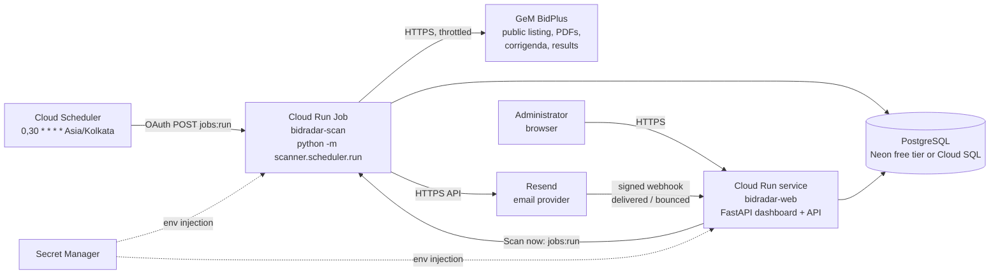

# Architecture

## 1. Cloud topology (Google Cloud, region asia-south1 / Mumbai)

**Why this shape**
- **The scanner is a Job, not a web request.** A scan takes minutes because of polite 3 s throttling. Cloud Run
  Jobs allow long tasks (task timeout 28 min), retry on a non-zero exit, and cost nothing between runs. Cloud
  Scheduler supports standard cron with an explicit time zone, so `0,30 * * * *` in Asia/Kolkata gives exactly
  :00 and :30 IST.
- **The dashboard is a separate, scale-to-zero service** (0–2 instances). Neither part needs any user device to
  be on.
- **Postgres holds all state:** tenders, history, queue, settings, lock and logs. Containers are disposable.
  SQLite is used only for local development and tests.
- **One container image serves both roles,** so the scanner and dashboard always run the same code version.

Alternatives considered (Phase 3 research):
- **Render:** its free Postgres expires after about 30 days, and cron is paid.
- **A laptop cron job:** forbidden by the brief.
- **Cloud Functions:** shorter timeouts. Cloud Run Jobs are a better fit for minutes-long throttled crawls.

## 2. One scan, step by step (`scanner/discovery/pipeline.py`)

1. **Lock and slot** (`scanner/scheduler/run.py`):
   - Take the `scan` lease lock (atomic conditional UPDATE, 25 min lease, expires if a worker dies).
   - Record missed slots since the last run, then claim the `(slot, trigger)` execution row.
   - A slot that already ran becomes a no-op. A failed slot may be retried. Paused monitoring is recorded as
     `skipped_paused`.
2. **Discovery.** For every enabled source and every search term, the scanner fetches pages newest-first. It stops
   paging a term as soon as a page has nothing new or changed. Catch-up after missed slots pages deeper (4 pages
   instead of 2).
3. **Upsert and change detection.** Identity is `(source_key, external_id)`; for GeM, a bid and its reverse auction
   share the parent bid id. Each listing is diffed against the stored state:
   - deadline (≥ 60 s), status and cancellation;
   - quantity and value;
   - title/description, where only meaningful wording changes count (token-set similarity < 92).

   Every change is an append-only row in `tender_status_history`, and each state is fingerprinted into
   `bid_observations`.
4. **Scoring.** All enabled categories are scored, and the best one becomes `best_category`. Per-category
   breakdowns are stored in `tender_matches`.
5. **Documents.** For tenders scoring 40 or more (budget: 40 PDFs per scan), the scanner:
   - downloads and extracts the PDF text layer, keeps English lines and redacts emails and phones;
   - parses GeM fields, then re-scores with document evidence;
   - builds the eligibility, requirements and issues lists.
6. **Refresh tracked tenders.** Relevant or watched tenders are re-checked on a schedule:
   - hourly within ±48 h of the deadline;
   - every 6 h while awaiting results;
   - every 4 h otherwise.

   Each refresh checks the listing status, corrigendum flag and list, and the public result page. A new
   corrigendum marks the bid document for re-reading, and eligibility diffs are computed on the next pass.
7. **Close expired.** Active tenders more than 30 minutes past their deadline become `closed` locally until the
   portal reports more.
8. **Notify.**
   - New relevant tenders and significant changes are rendered and queued with deterministic dedupe keys.
   - Alerts are filtered by threshold, enabled categories, geography and per-event preferences.
   - The queue is then flushed and due summaries are created.
9. **Finish.**
   - Stats are written to `scan_executions`.
   - Source health is updated (consecutive failures, last error, `inaccessible` after 6 failed scans).
   - The lock is released.
   - The exit code is non-zero if every source failed, so Cloud Run retries.

## 3. Data model (PostgreSQL)

| Table | Purpose |
|---|---|
| `sources` | registry and health of every portal (enabled / disabled / requires_auth / requires_captcha / inaccessible / unreliable) |
| `categories`, `keywords` | business categories and editable keywords (phrase, synonym, discovery, object, action, negative, weight) |
| `tenders` | one row per procurement; extracted fields, score, explanation, `details` JSON (eligibility, issues, corrigenda, outcome, redacted doc text) |
| `tender_matches` | per-category score, matched terms, breakdown |
| `tender_documents` | each PDF: status, sha256, pages, redacted excerpt, extracted fields |
| `tender_status_history` | append-only change events (old → new, significant flag, scan id) |
| `bid_observations` | fingerprinted snapshot whenever a tender's observable state changes |
| `scan_executions` | one row per slot and trigger: status, timings, stats, error |
| `scan_errors`, `system_events` | monitoring logs |
| `scheduler_locks` | lease lock |
| `email_notifications`, `email_delivery_attempts`, `suppressed_notifications` | queue, attempt log, dedupe audit |
| `app_settings` | dashboard-editable settings (JSON) |

Schema changes go through Alembic (`database/migrations`). `database/schema/schema.sql` is the rendered
PostgreSQL DDL, kept for review.

## 4. Reliability features

| Risk | Mitigation |
|---|---|
| Overlapping scans | DB lease lock; second trigger recorded as `skipped_locked` |
| Duplicate scheduler delivery / retries | unique `(slot_at, trigger)`; `already_ran` no-op |
| Missed runs (outage, quota) | gap detection creates `missed` rows plus a dashboard banner; next run catches up deeper |
| Crashed worker | lease expiry; failed row retried by Cloud Run task retry |
| Portal slow or down | 15 s connect timeout; retries with backoff and jitter; circuit breaker per source; scan continues with other sources |
| Portal layout change | parser errors become `scan_errors`; CSRF-token check fails loudly |
| One bad PDF | document marked `failed`, retried after 6 h; scan still succeeds |
| Duplicate tenders / alerts | unique keys at every level plus deterministic notification dedupe keys |
| Email outages | retries with 5 → 15 → 45 → 135 min backoff (max 5 attempts), then `failed`, visible in the dashboard |
| False "delivered" | only a Svix-signed `email.delivered` webhook sets `delivered` |
| Database growth | about 25 KB redacted text per analysed document; estimates in COST_ESTIMATE.md |

## 5. Key technical decisions

- **Python, FastAPI, server-rendered Jinja.** There is no JavaScript build chain. The dashboard works under a
  strict CSP (`script-src 'self'`, no inline scripts).
- **Deterministic matching first.** Every score is explainable and testable. The embedding model is optional
  (`EMBEDDING_BACKEND=fastembed`) because it adds a ~150 MB download and cold-start time for small gains on
  short titles.
- **Times are UTC in the database and IST everywhere a human sees them.** GeM's listing timestamps are IST
  wall-clock values with a misleading `Z` suffix; they are converted explicitly (`core/timeutil.py`).
- **Privacy by construction.** Buyer login ids are dropped at the adapter. Contact details are redacted before
  storage. Losing bidders are never named, and the L1 name is kept only after award.
